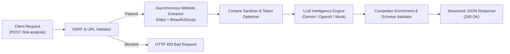

# AI-Powered Website Link Analysis API

An autonomous market intelligence, SEO diagnostics, and competitive benchmarking microservice built with **Python 3.x** and **FastAPI**.

Given any public website URL, the service crawls and sanitizes the page content, runs structured analytical inference through Large Language Models, and returns a verified JSON intelligence report across five distinct business dimensions.

---

## Key Features

- **5-Pillar Structured Intelligence**:
  1. **Competitor vs Brand Benchmarking**: Direct head-to-head comparison against at least 3 verified industry competitors (strengths, gaps, and positioning opportunities).
  2. **Top 5 Multi-Platform Search Queries**: Discovery queries spanning Google Search, LinkedIn, Facebook, Instagram, and X (Twitter) with intent and persona mapping. *(Strict rule: No hallucinated search volumes)*.
  3. **Actionable SEO Diagnostics**: Keyword recommendations (primary, secondary, long-tail), optimized title tags (< 60 chars), meta descriptions (< 160 chars), and content cluster expansions.
  4. **Top 5 Service Offerings**: Core capabilities with target industries, buyer personas, quantifiable benefits, and content provenance labeling (`extracted_from_content` vs `inferred_recommendation`).
  5. **Target Audience Identification**: Multi-tier segmentation, decision-maker personas, business types, customer pain points, and geographic focus.
- **Enterprise-Grade SSRF Protection**: Validates all input URLs against loopback (`127.0.0.1`, `localhost`), private RFC 1918 subnets (`10.0.0.0/8`, `172.16.0.0/12`, `192.168.0.0/16`), cloud instance metadata endpoints (`169.254.169.254`), and follows redirects with re-validation.
- **Multi-Provider LLM Integration**: Production support for **Google Gemini** (`gemini-1.5-flash`), **OpenAI** (`gpt-4o-mini`), and an offline deterministic mock provider for zero-credential local testing and CI/CD pipelines.
- **Token-Efficient Web Scraping**: Strips non-semantic elements (`<script>`, `<style>`, `<svg>`, `<nav>`, `<footer>`) and extracts structured OpenGraph and heading signals to reduce token consumption by up to 85%.

---

## Architecture Flow



---

## Project Structure

```
ai-link-analysis/
│
├── app/
│   ├── __init__.py
│   ├── main.py                  # FastAPI application entrypoint & middleware
│   ├── config.py                # Pydantic runtime settings
│   ├── schemas.py               # Request/response validation schemas
│   │
│   ├── services/
│   │   ├── __init__.py
│   │   ├── website_extractor.py # Safe crawler, DOM cleanser & metadata parser
│   │   ├── llm_service.py       # Gemini, OpenAI & Mock LLM providers
│   │   ├── competitor_service.py# Competitor verification & benchmarking
│   │   └── analysis_service.py  # End-to-end orchestration pipeline
│   │
│   └── utils/
│       ├── __init__.py
│       └── validators.py        # SSRF prevention and IP address resolution
│
├── tests/
│   ├── __init__.py
│   ├── conftest.py              # Test fixtures and test client
│   └── test_link_analysis.py    # Unit & end-to-end API test suite
│
├── docs/
│   └── LLM_RESEARCH.md          # Comprehensive LLM benchmarks, pricing & analysis
│
├── .env.example                 # Sample environment variables
├── .gitignore
├── requirements.txt             # Project dependencies
├── Dockerfile                   # Container build definition
├── docker-compose.yml           # Local multi-container orchestration
└── README.md
```

---

## Quickstart Guide

### 1. Prerequisites
- Python 3.10+ (tested on Python 3.11)
- Git

### 2. Installation

Clone the repository and enter the project directory:
```bash
git clone <your-repo-url>
cd ai-link-analysis
```

Create and activate a virtual environment:
```bash
# macOS/Linux
python3 -m venv .venv
source .venv/bin/activate

# Windows
python -m venv .venv
.venv\Scripts\activate
```

Install dependencies:
```bash
pip install -r requirements.txt
```

### 3. Environment Configuration

Copy the sample environment file:
```bash
cp .env.example .env
```

Edit `.env` to select your preferred LLM provider:
```ini
HOST=0.0.0.0
PORT=4000
DEBUG=False

# Provider selection: "gemini", "openai", or "mock"
LLM_PROVIDER=gemini

# Google Gemini (Recommended for cost/speed)
GEMINI_API_KEY=your_gemini_api_key_here
GEMINI_MODEL=gemini-1.5-flash

# OpenAI Alternative
OPENAI_API_KEY=your_openai_api_key_here
OPENAI_MODEL=gpt-4o-mini
```

> **Note**: If no API key is supplied or `LLM_PROVIDER=mock` is set, the service operates using the built-in deterministic offline mock provider, allowing full evaluation without incurring API costs.

### 4. Running the Server

Start the application with Uvicorn:
```bash
uvicorn app.main:app --host 0.0.0.0 --port 4000 --reload
```

The API will be accessible at:
- **Service Root**: `http://localhost:4000`
- **Interactive Swagger Docs**: `http://localhost:4000/docs`
- **Health Check**: `http://localhost:4000/health`

---

## API Reference

### Health Check

```bash
curl -X GET "http://localhost:4000/health"
```

**Response**:
```json
{
  "status": "healthy",
  "service": "AI-Powered Website Link Analysis API",
  "version": "1.0.0",
  "llm_provider": "gemini",
  "ssrf_protection": true
}
```

---

### Link Analysis Endpoint

- **Method**: `POST`
- **URL**: `http://localhost:4000/link-analysis`
- **Content-Type**: `application/json`

#### Sample Request

```bash
curl -X POST "http://localhost:4000/link-analysis" \
  -H "Content-Type: application/json" \
  -d '{
    "url": "https://stripe.com"
  }'
```

#### Sample Response

```json
{
  "success": true,
  "website": "https://stripe.com/",
  "brand": {
    "name": "Stripe",
    "category": "Financial Technology (FinTech) & Payments",
    "summary": "Stripe is a financial infrastructure platform for businesses, powering payments, billing, and global financial operations."
  },
  "analysis": {
    "competitor_analysis": {
      "brand_overview": "Stripe dominates developer-first online payments with comprehensive global infrastructure and unified financial APIs.",
      "competitors": [
        {
          "name": "Adyen",
          "main_service": "Unified Global Omnichannel Payments",
          "target_market": "Large Global Enterprises & Retailers",
          "key_strengths": "Direct acquiring licenses and unified in-store point of sale infrastructure",
          "weaknesses_or_gaps": "Higher technical barriers to entry for early-stage startups",
          "opportunity": "Maintain dominance in developer experience and modular startup-to-enterprise scaling"
        },
        {
          "name": "PayPal / Braintree",
          "main_service": "Digital Wallet & Merchant Gateway",
          "target_market": "Consumer E-Commerce & Global SMBs",
          "key_strengths": "Massive global consumer brand trust and digital wallet adoption",
          "weaknesses_or_gaps": "Fragmented developer documentation and legacy API architecture",
          "opportunity": "Deliver superior automated dispute management and unified billing workflows"
        },
        {
          "name": "Square (Block)",
          "main_service": "Integrated POS & Small Business Financial Services",
          "target_market": "Brick-and-mortar SMBs and Hybrid Retailers",
          "key_strengths": "Turnkey hardware ecosystem and simple merchant onboarding",
          "weaknesses_or_gaps": "Limited complex international multi-currency settlement capabilities",
          "opportunity": "Expand cross-border internet business infrastructure for emerging markets"
        }
      ],
      "strengths": [
        "Gold-standard API documentation and developer tooling ecosystem",
        "Comprehensive financial suite spanning payments, fraud prevention (Radar), and billing",
        "Global regulatory compliance and multi-currency payout network"
      ],
      "opportunities": [
        "Deepen native AI-driven revenue recovery and automated invoice reconciliation",
        "Expand embedded finance capabilities for vertical SaaS platforms",
        "Accelerate local payment method support in high-growth emerging economies"
      ]
    },
    "target_search_queries": [
      {
        "query": "Best payment gateway for SaaS companies",
        "platforms": ["Google"],
        "intent": "Service Discovery",
        "business_relevance": "Captures high-intent subscription software founders evaluating payment vendors",
        "target_audience": "CTO / Head of Engineering"
      },
      {
        "query": "Global billing automation platform for B2B",
        "platforms": ["LinkedIn"],
        "intent": "B2B Commercial Investigation",
        "business_relevance": "Reaches finance leaders managing complex recurring revenue models",
        "target_audience": "VP of Finance / Chief Revenue Officer"
      },
      {
        "query": "Stripe vs Adyen pricing and enterprise features",
        "platforms": ["Google", "X"],
        "intent": "Evaluation / Comparison",
        "business_relevance": "Engages late-stage enterprise procurement teams comparing tier-1 providers",
        "target_audience": "Procurement Director & Solutions Architect"
      },
      {
        "query": "Developer-friendly recurring payment integration",
        "platforms": ["LinkedIn", "X"],
        "intent": "Technical Discovery",
        "business_relevance": "Builds developer advocacy through API design leadership",
        "target_audience": "Software Architects and Full-Stack Engineers"
      },
      {
        "query": "How to accept international payments online",
        "platforms": ["Google", "Facebook"],
        "intent": "Educational / Top-of-Funnel",
        "business_relevance": "Attracts early-stage cross-border merchants seeking expansion guides",
        "target_audience": "SMB Founders and E-Commerce Operators"
      }
    ],
    "seo_improvements": {
      "primary_keyword": "Stripe payment infrastructure",
      "secondary_keywords": [
        "online payments platform",
        "recurring billing software",
        "fraud prevention API",
        "global payout platform"
      ],
      "long_tail_keywords": [
        "how to integrate global payments in nextjs",
        "best payment gateway for international subscription billing",
        "developer guide to automated tax compliance and billing"
      ],
      "recommended_title": "Stripe | Financial Infrastructure for the Internet",
      "meta_description": "Stripe powers online payments and financial infrastructure for millions of businesses, from high-growth startups to global enterprises. Get started today.",
      "supporting_content": [
        "Global Tax Compliance: The Complete Regulatory Guide for Cross-Border Sellers",
        "Interactive SaaS Pricing & Revenue Leakage ROI Calculator",
        "Enterprise Migration Blueprint: Transitioning Legacy Payment Gateways Without Downtime"
      ]
    },
    "top_services": [
      {
        "service_name": "Stripe Payments",
        "description": "Complete global payment acceptance suite supporting credit cards, mobile wallets, and 100+ local currencies.",
        "target_industry": "E-Commerce, Digital Goods, & Enterprise Platforms",
        "target_customer": "VP of Payments / Engineering Leads",
        "main_benefit": "Increases checkout conversion and lowers transaction decline rates",
        "source": "extracted_from_content"
      },
      {
        "service_name": "Stripe Billing",
        "description": "Automated recurring billing, usage-based invoicing, and automated revenue recognition engine.",
        "target_industry": "Subscription SaaS & Digital Media",
        "target_customer": "Chief Financial Officers & Revenue Operations",
        "main_benefit": "Automates churn prevention and reduces subscription revenue leakage by up to 38%",
        "source": "extracted_from_content"
      },
      {
        "service_name": "Stripe Connect",
        "description": "Platform infrastructure for marketplaces and software platforms to accept payments and pay out sellers globally.",
        "target_industry": "Multi-Vendor Marketplaces & Gig Economy",
        "target_customer": "Platform Product Managers & Founders",
        "main_benefit": "Handles complex multi-party payouts and regulatory compliance automatically",
        "source": "extracted_from_content"
      },
      {
        "service_name": "Stripe Radar",
        "description": "Machine learning fraud detection system trained on transactions across billions of global network interactions.",
        "target_industry": "All Online Merchants",
        "target_customer": "Risk & Fraud Managers",
        "main_benefit": "Blocks fraudulent charges while minimizing false positives for legitimate customers",
        "source": "extracted_from_content"
      },
      {
        "service_name": "Stripe Treasury & Issuing",
        "description": "Embedded banking as a service allowing platforms to issue programmable cards and store funds.",
        "target_industry": "Vertical SaaS & Modern Scaleups",
        "target_customer": "FinTech Product Leaders",
        "main_benefit": "Enables software businesses to unlock new revenue streams with embedded banking",
        "source": "inferred_recommendation"
      }
    ],
    "target_audience": {
      "primary_audience": [
        "Chief Technology Officers (CTOs) and VP of Engineering",
        "Chief Financial Officers (CFOs) and VP of Finance"
      ],
      "secondary_audience": [
        "Product Managers leading billing and checkout optimization",
        "Software Developers integrating payment APIs"
      ],
      "industries": [
        "B2B SaaS & Subscription Platforms",
        "E-Commerce & Multi-Sided Marketplaces",
        "On-Demand Services & Gig Economy Platforms",
        "Global Digital Media & Streaming Services"
      ],
      "business_types": [
        "Early-Stage High-Growth Startups",
        "Mid-Market Scaleups",
        "Global Fortune 500 Enterprises"
      ],
      "customer_profiles": [
        "Technical Leader prioritizing developer velocity, reliability, and security",
        "Finance Director seeking automated revenue recognition and tax handling"
      ],
      "geographical_focus": "Global across 195+ countries",
      "customer_needs": [
        "High availability and fault-tolerant payment processing",
        "Turnkey support for localized payment methods globally",
        "Predictable fee structures and automated reconciliation reporting"
      ],
      "customer_interests": [
        "Developer API ergonomics and SDK support",
        "Machine learning fraud mitigation",
        "Autonomous accounting and tax automation"
      ],
      "recommended_segments": [
        "Tier 1: Global Enterprise Accounts (Custom IC+ pricing & dedicated account engineering)",
        "Tier 2: Scaleup SaaS (Self-serve documentation, webinars, and partner ecosystem integrations)",
        "Tier 3: Early-Stage Startups (Startup program credits, fast sandbox onboarding)"
      ]
    }
  },
  "metadata": {
    "duration_seconds": 2.148,
    "model_provider": "gemini",
    "model_name": "gemini-1.5-flash",
    "extracted_text_length": 4820
  }
}
```

---

## Security & SSRF Protection

To prevent Server-Side Request Forgery attacks, the `app.utils.validators` module implements strict validation:
- **Forbidden Protocols**: Only `http://` and `https://` schemes are permitted. Schemes such as `file://`, `ftp://`, or `gopher://` are rejected with HTTP 400.
- **DNS IP Verification**: Hostnames are resolved to IP addresses via `socket.getaddrinfo`.
- **Blocked Ranges**:
  - Loopback addresses (`127.0.0.0/8`, `::1`)
  - Private RFC 1918 ranges (`10.0.0.0/8`, `172.16.0.0/12`, `192.168.0.0/16`)
  - Link-Local and Cloud Metadata addresses (`169.254.169.254` used by AWS, Azure, and GCP)
  - Multicast and reserved ranges
- **Redirect Safeguards**: Redirect chains are re-validated at each step to prevent open-redirect SSRF bypasses.

---

## Running the Test Suite

The test suite covers URL security, SSRF detection, DOM sanitization, LLM schema conformance, and end-to-end API responses:

```bash
python -m pytest tests/ -v
```

**Expected output**:
```
tests/test_link_analysis.py::test_valid_urls_allowed PASSED              [  7%]
tests/test_link_analysis.py::test_invalid_scheme_rejected PASSED         [ 14%]
tests/test_link_analysis.py::test_ssrf_loopback_blocked PASSED           [ 21%]
tests/test_link_analysis.py::test_ssrf_cloud_metadata_blocked PASSED     [ 28%]
tests/test_link_analysis.py::test_ssrf_private_network_blocked PASSED    [ 35%]
tests/test_link_analysis.py::test_html_parsing_logic PASSED              [ 42%]
tests/test_link_analysis.py::test_empty_content_raises_error PASSED      [ 50%]
tests/test_link_analysis.py::test_mock_llm_service PASSED                [ 57%]
tests/test_link_analysis.py::test_clean_json_response_helper PASSED      [ 64%]
tests/test_link_analysis.py::test_health_check_endpoint PASSED           [ 71%]
tests/test_link_analysis.py::test_root_endpoint PASSED                   [ 78%]
tests/test_link_analysis.py::test_post_link_analysis_success PASSED      [ 85%]
tests/test_link_analysis.py::test_post_link_analysis_ssrf_blocked PASSED [ 92%]
tests/test_link_analysis.py::test_post_link_analysis_invalid_scheme PASSED [100%]

============================= 14 passed in 0.39s ==============================
```

---

## Docker Deployment

Build and run using Docker Compose:
```bash
docker-compose up --build -d
```

Verify service status:
```bash
docker-compose ps
curl http://localhost:4000/health
```

Stop containers:
```bash
docker-compose down
```

---

## LLM Platform & Model Research Summary

A full evaluation report is available in [docs/LLM_RESEARCH.md](docs/LLM_RESEARCH.md). Key findings include:

1. **Recommended Model**: **Google Gemini 1.5 Flash**
   - **Cost**: $0.075 / 1M input tokens, $0.30 / 1M output tokens (approx. **$0.00062 per analysis**).
   - **Speed**: ~140 tokens/sec with median generation duration under 2.5 seconds.
   - **JSON Reliability**: Built-in `response_mime_type="application/json"` guarantees strict schema adherence.
2. **Fallback Model**: **OpenAI GPT-4o-mini**
   - **Cost**: $0.15 / 1M input tokens, $0.60 / 1M output tokens (approx. **$0.00125 per analysis**).
   - **Speed**: ~110 tokens/sec.
3. **Token Optimization**:
   - Stripping script/style tags and non-semantic DOM elements reduces token payload by **up to 85%**.
   - Input length is capped with word-boundary preservation.
   - Structured JSON mode eliminates conversational filler tokens.

---

## License

This project is licensed under the MIT License.
